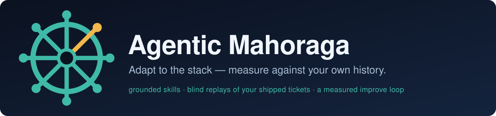
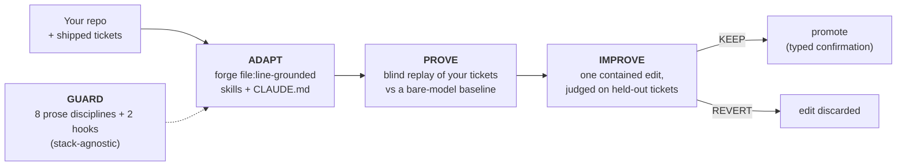

<!-- Identity is defined once in branding.yaml; this README mirrors it. -->

<div align="center">



**Forges file:line-grounded skills from your code, then replays your own shipped tickets blind — against a bare-model baseline — to measure whether they help.**

[](https://github.com/ahmadrishi/agentic-mahoraga/actions/workflows/ci.yml) [](CHANGELOG.md) [](LICENSE) [](#limits) [](#install)

[Install](#install) · [How it works](#how-it-works) · [Quickstart](#quickstart) · [Limits](#limits) · [Security](#security) · [Docs](docs/README.md)

<sub>The name comes from Mahoraga, a character in the anime and manga <i>Jujutsu Kaisen</i>. This is an independent project, not affiliated with or endorsed by its creators or publishers.</sub>

</div>

## Install

In Claude Code (tested with 2.1.290):

```
/plugin install mahoraga --marketplace ahmadrishi/agentic-mahoraga
```

Then, in your repo, run `/mahoraga-init` (see [Quickstart](#quickstart)).

**You need** `bash`, `git`, Python 3.8+ with PyYAML (`pip install pyyaml`), and Node.js for the mapping lint
(`scripts/conformance-lint.mjs`). The measured loop (`mahoraga loop`) also needs Linux and Docker.

<details>
<summary><strong>Other agents, or from a clone</strong></summary>

<br>

**Claude Code first.** Hooks are a Claude Code primitive, so the GUARD hooks only run there. The npm
package is **not yet published**; from a clone, run the CLI as `bash cli/mahoraga <command>` (or
`npx . <command>`). **Cross-agent install is built:**
`bash cli/mahoraga install --target <your agent's skills dir>` copies the 8 GUARD skills there
(default `~/.agents/skills`; `--agent` only labels the output). The hooks don't port, so there GUARD
is prose only.

</details>

## Why it exists

Most agent harnesses give you a *method to follow* ([spec-kit](https://github.com/github/spec-kit),
[BMAD](https://github.com/bmad-code-org/BMAD-METHOD)) or *reusable rule files*
([Pocock's skills](https://github.com/mattpocock/skills), cursor-rules) or *style standards learned
from your code* (Agent OS). Agentic Mahoraga focuses on the piece they leave out: **measuring a skill
setup against your own merged work**, blind, with a bare-model baseline. (The idea has research
precedents — see [How it compares](#how-it-compares).)

## How it works



Four verbs, one wheel — but **only GUARD is meant to be universal**:

| | What it does | Today |
|---|---|---|
| **ADAPT** | forge a grounded `<project>-mapping` skill (always — it reads your code) and, where a spec corpus exists, a `<project>-spec` skill | per-project |
| **GUARD** | a small, **stack-agnostic** behavioral pack — 8 prose disciplines + 2 Claude Code hooks — aimed at the mistakes models make regardless of stack. The hooks **warn by default**; `MAHORAGA_SMALL_DIFF_MODE=block` makes the size gate a hard gate | day one, any project |
| **PROVE** | blind-reimplement your shipped tickets in history-free sandboxes → score vs the human diff (as a *reference*, never a match target) and vs a bare-model baseline | the distinctive move |
| **IMPROVE** | learn from earlier tickets → one contained edit to the always-on guidance → judged on later, held-out tickets by a sealed rule; only a KEEP can be promoted | **code** (`mahoraga loop run`). The `/mahoraga-improve` path (skill edits) is model-instructed |

Today Mahoraga builds a grounded vocabulary for Python, TS/JS, Java and Go, stages blind, leak-gated
replays of your shipped work, and runs a measured improve loop (`mahoraga loop`, Linux + Docker) that
keeps an edit to the agent's always-on guidance only if it helps on later tickets it never learned
from.

**What a new project actually gets:** the GUARD pack (day one) + one forged mapping skill (+ a spec
skill where a doc corpus exists) + a generated `CLAUDE.md`. It does **not** conjure a large
platform-specific skill library for free — it *accelerates* building one.

*Named for Mahoraga from the anime and manga Jujutsu Kaisen, whose Wheel of the Eightfold adapts to any
attack it survives once — the aspiration this project is built toward.*

## Quickstart

The slash commands run inside Claude Code and instruct the model. (`/mahoraga-loop` hands the
measuring to `mahoraga loop`, which is code.)

| In Claude Code, opened in your repo | What it does |
|---|---|
| `/mahoraga-init` | draft `PROJECT.yaml` for you to confirm (the one setup gate) |
| `/mahoraga-adapt` | forge the grounded `<project>-mapping` (+ spec) skills + a `CLAUDE.md` |
| `/mahoraga-prove` | blind-reimplement your shipped units → a scored, ablated report |
| `/mahoraga-loop` | prepare SPEC/BR, then run `mahoraga loop run` and report its decision |
| `/mahoraga-improve` | turn findings into skill edits (you approve every diff; unmeasured) |
| `/mahoraga-retest` | re-run the failed units with the edited skills (same units: not a held-out test) |

<details>
<summary><strong>The measured loop</strong> — code, Linux + Docker</summary>

<br>

The loop is code (`core/loop/`; [`core/loop/README.md`](core/loop/README.md)). It needs a `loop:`
block in `PROJECT.yaml` and a Claude credential; `--scorer codex` also needs an OpenAI key:

```bash
bash cli/mahoraga loop preflight --paid       # boundary probe + the skill canary (a few cents)
bash cli/mahoraga loop run --config PROJECT.yaml --campaign r1 --units <shas, oldest first> \
  --scorer codex --scorer-model gpt-5.4 --budget-usd 45 --builtins <canary.json> --dry-run   # split, cost, power
bash cli/mahoraga loop promote --config PROJECT.yaml --campaign r1    # only a valid KEEP; typed confirmation
```

</details>

<details>
<summary><strong>See the loop without a model session</strong> — a 3-step mechanical demo (no LLM)</summary>

<br>

A scan stands in for the adaptive forge, and stub implementers stand in for the blind LLM:

```bash
# 1. draft the config + CLAUDE.md
bash cli/mahoraga init                                               # or: npx . init
# 2. scaffold the mapping skill's names table deterministically (the code-grounded step under ADAPT)
python3 core/lib/mapping_scan.py <repo> --lang <lang> --format md    # scaffold a <project>-mapping skill
node scripts/conformance-lint.mjs .claude/skills/<project>-mapping --repo <repo>   # shape + every path:line resolves
# 3. mechanical two-arm prove -> an ablated, cutoff-labelled report
bash tests/quickstart_test.sh    # runs the steps above in a scratch copy, then a stub-scored two-arm prove
```

The test's steps are not chained: step 2 scans Mahoraga's own `core/lib`, and the prove step runs on
`examples/py-service`.

**What the demo shows — and doesn't.** The committed fixture runs
([`examples/ts-app/RUN.md`](examples/ts-app/RUN.md), [`examples/py-service/RUN.md`](examples/py-service/RUN.md);
reproduce with `bash tests/prove_ablation_test.sh`) use **hard-coded stub scores** in place of the
blind LLM, so the **"+35" is arithmetic on constants**: it shows the ablation report works, not that
the harness helps. The py-service harness skill also paraphrases the fixture's answer — a leak the
identifier-level gate cannot see — and py-service is labelled `cutoff-clean` only because its
`PROJECT.yaml` declares it private. A dependable number needs a live run (`mahoraga loop`, or
`/mahoraga-prove`) on **private / post-cutoff** work.

</details>

## Limits

Mahoraga is **early (v0.1)**. What to know before you rely on it:

- **Claude Code first.** The GUARD hooks only run there; other agents get the 8 prose skills through `mahoraga install`.
- **Languages.** The mapping forge names code deterministically for Python, TS/JS, Java and Go. If the dominant (or requested) language has no extractor, or the requested one is under 10% of the source, the scan exits 3 instead of mapping junk; `--allow-generic` and `--allow-partial` override that.
- **The measured loop needs Linux + Docker and model credit** (Claude; an OpenAI key for the Codex scorer). It costs real money: a minimal PROVE run (2 tickets × 2 arms × 3 runs) was about $2, and full campaigns run to tens of dollars (the examples budget $20–45). `--dry-run` shows the split, cost and power first.
- **The held-out gate refuses the `jira` and `file` trackers.** `loop gate` and `loop run` need merge dates that order the tickets; use `github-pr`, `gitea` or `none`.
- **"Blind" is identifier-level.** The leak gate catches leaked identifiers, not paraphrased answers. Treat a headline number as dependable only on private or post-cutoff work.
- **Slash commands are v0.1 protocols.** They instruct the model; `mahoraga loop` is the code-enforced path.
- **No measured win yet.** The improve loop works and its controls behave, but no edit has earned a KEEP on a real repo so far. A REVERT is a normal, expected outcome, not an error.

## Security

Mahoraga generates and edits **code-executing skills** in your repo, and Prove sends your **private
merged work to model APIs** (Anthropic, and OpenAI when the loop's Codex scorer is used). Read
[`SECURITY.md`](SECURITY.md) before use. In short: the forge is read-only on your repos **by
instruction** (not enforced in code); on the slash-command path, skill add/edit approval rests on
your Claude Code permission prompts (absent in bypass or headless mode), while `mahoraga loop` writes
to your project only through `loop promote` (a valid KEEP, then a typed confirmation); the marketplace entry is
**not yet SHA-pinned**; and any headline eval number must come from
**private or post-cutoff** work.

## How it compares

- **Plan your work:** `spec-kit` and `BMAD`. **Learn your code's *style*:** `Agent OS`. **Sharp reusable
  disciplines:** `Pocock's skills`.
- **Research precedents for the core loop:** *Learning to Commit*
  ([arXiv 2603.26664](https://arxiv.org/abs/2603.26664)) blindly re-attempts a repo's earlier commits
  and distils the gap into memory, and *Skill Issue* ([arXiv 2609.12742](https://arxiv.org/abs/2609.12742))
  scores skill files with vs without on reverted merged PRs.
- **Ideas ported, no code copied:** the measured loop's mechanisms (the planned-before-spend ledger,
  validate-and-retry, learning only from earlier tickets, the proposer tripwire) come from Google
  Research's *Harness²* ([arXiv 2610.14224](https://arxiv.org/abs/2610.14224)).

**Mahoraga's contribution is packaging, not invention:** an installable, tracker-adapted Claude Code
harness that runs that idea on a team's own private history, with explicit decontamination and
cutoff labels.

## Layout

```
core/      module-agnostic engine — lib/ (the port), adapters/ (tracker·spec·vcs·verify), schema/,
           loop/ (the measured improve loop)
skills/    guard/ (the GUARD pack) · adapt/ + prove/ (the engine skills, stripped from sandboxes)
cli/       the `mahoraga` command
commands/  the Claude Code slash commands
docs/      adapter contract · decontamination methodology · skill schema · the loop's sealed rule
examples/  reference repos (a TS app, a Python service)
```

## Contributing

New tracker adapters are small and welcome; see [`CONTRIBUTING.md`](CONTRIBUTING.md) and the
[adapter contract](docs/ADAPTER-CONTRACT.md). All contributed code is reviewed for security
(SECURITY.md) — adapters run in every user's repo.

## License

[MIT](LICENSE).
